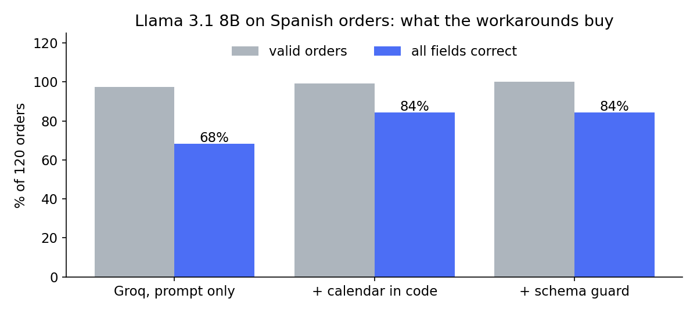
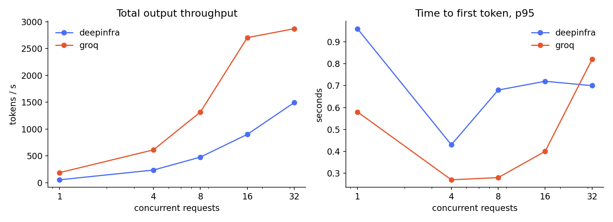

# order-inference-bench

**A customer's agent workload, moved onto open-weight inference: measured, broken, and fixed in a day.**

The workload: turn Spanish B2B orders (emails, WhatsApp messages, voice-note transcripts, corrections, relative dates)
into structured orders against a 68-SKU catalog. It's a real shape from my client work, rebuilt here with synthetic data so
no customer data leaves their systems.

The question a customer actually asks: *can a small open model (Llama 3.1 8B) do this reliably, fast and cheap, and on
which provider?*



## What I found

| | Result |
|---|---|
| Out of the box | Llama 3.1 8B gets **60–68%** of orders fully right on every provider. Dates (78–80%) and corrections (45–65%) are the weak spots. |
| Same model, five providers | **~10× spread in cost** ($0.04–0.47 per 1k orders) and **~14× spread in p95 latency** (0.47 s → 6.6 s). |
| JSON schema enforcement | **4 of 5 providers reject it** for this model (3 "not supported", 1 "not with streaming"). |
| The one that enforces it | **corrupts non-ASCII text**: 32 of 38 orders with an accented customer or city came back with control characters (`Mesón` → `Mes\u0004on`); 0 of 38 without the schema. 4/120 outputs looped until max_tokens. Accuracy went *down* (60% → 57.5%). |
| Workaround 1: calendar in code | Resolve "mañana / el viernes" in code, let the model pick: dates **80% → 97.5%**, all-fields **68% → 84%**. |
| Workaround 2: schema guard | validate → one repair turn with the exact error → fall back to a second provider: **100% valid orders**, p95 0.52 s, $0.077 / 1k. |
| Load | Groq: ~700 tok/s per user, throughput knee between 16 and 32 concurrent (TTFT p95 doubles). DeepInfra: ~100 tok/s per user, linear to 32. |

Full tables and charts: [`results/REPORT.md`](results/REPORT.md); customer write-up: [`docs/customer-report.md`](docs/customer-report.md);
note to engineering: [`docs/field-note-engineering.md`](docs/field-note-engineering.md).



## Run it

```bash
pip install httpx pydantic matplotlib fastapi uvicorn
export OPENROUTER_API_KEY=...
cd bench
python make_eval.py 120                                   # synthetic eval set with exact gold labels
python run_eval.py --target groq --mode prompt            # quality + latency + cost for one provider
python run_eval.py --target groq --mode prompt --calendar # workaround 1
python guard.py --primary groq --fallback deepinfra --calendar   # workaround 2
python load_test.py --target groq --levels 1,4,8,16,32    # throughput / TTFT vs concurrency
python report.py                                          # tables + charts
uvicorn guard:app --port 8090                             # the guard as a drop-in OpenAI-compatible proxy
```

Self-hosted: `scripts/serve_local.sh` runs llama.cpp (`--parallel` slots, KV cache size, optional speculative decoding with a
1B draft model) and `prefix_cache.py` measures prefix caching on/off and the "date at the top of the prompt" trap.

## Design choices worth knowing
- **One provider pinned per run, no fallbacks** (`provider.only`, `allow_fallbacks: false`), otherwise you benchmark the router.
- **Stable prompt prefix**: catalog + rules + few-shot examples first, per-request data (today's date, the message) last, so
  prefix caching can work. Groq and CoreWeave reported ~1.5k cached tokens per request; three providers reported none.
- **Synthetic eval with exact gold labels**: generated from templates, so scoring is exact, not LLM-judged.
- Temperature 0; reruns are reproducible (119/120 identical outputs on Groq and CoreWeave).

## Limits (read before quoting a number)
- **Noise:** 120 orders → a 68% score has a 95% interval of roughly ±8 points (1.96 × √(p(1−p)/n)), so provider totals
  (60–68%) overlap. Because every provider got the *same* orders, the sharper test is paired (exact McNemar): Groq vs
  CoreWeave split 12 vs 2 discordant orders (p ≈ 0.013), and a rerun gave 119/120 identical outputs, so the providers really do
  answer differently on ~1 in 9 orders. With 10 provider pairs compared, "Groq beats CoreWeave" is a lead, not a ranking.
  The calendar gain is solid: 25 orders fixed vs 6 broken (p < 0.001).
- **Synthetic data:** real message shapes, not real customers. Some misses are the answer key's fault, e.g. "una docena de
  unidades de almendras" answered as 1 box of 12 instead of 12 units: same almonds, scored wrong.
- **One day, one account, one region.** Provider latency moves hour to hour; the Groq knee may be an account rate limit, not hardware.
- **No self-hosted numbers yet.** The llama.cpp scripts are included; the local run was stopped to protect a shared machine.
